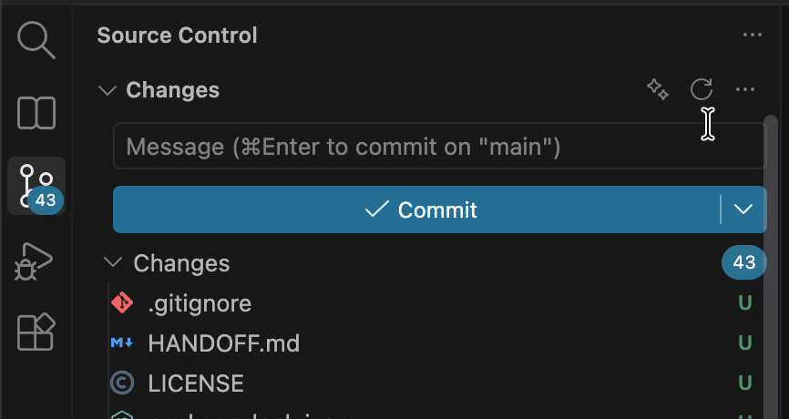

# Agent Commit

**Write commit messages with the coding agent you already use.**

Click ✨ on a repository in the Source Control view and the message shows up in that repository's commit box. Claude Code is the default, and any CLI that reads a prompt from stdin works.

Built for multi-root workspaces: each repository gets its own button, so the message always goes to the repository you clicked. You never have to pick a folder.

## Features

- **The right repository, every time.** The button sits on each repository header. Nested repositories resolve to the innermost one.
- **Matches your history.** The agent sees your last 15 commit subjects, so it follows your scopes, tone and language.
- **Staged first.** It uses staged changes. If nothing is staged, it uses all changes, including new files, and tells you.
- **Conventional Commits** by default, or the repository's own style.
- **Bring your own agent.** `claude -p`, `claude -p --model haiku`, or any other CLI.
- **Cancellable,** with a configurable timeout.

## Usage

1. *(Optional)* Stage the changes you want to commit.
2. Click ✨ on the repository header in **Source Control**.
3. Review the message and commit.

You can also run **Agent Commit: Generate Commit Message** from the Command Palette.

## Requirements

A coding-agent CLI on your `PATH` that reads the prompt from stdin and prints only the answer. The default, [Claude Code](https://docs.claude.com/en/docs/claude-code), must already be signed in.

## Settings

| Setting | Default | Description |
|---|---|---|
| `agentCommit.command` | `claude -p` | Command that receives the prompt on stdin. |
| `agentCommit.language` | `auto` | `auto` follows your recent commits. Or set a language: `English`, `Portuguese (Brazil)`… |
| `agentCommit.style` | `conventional` | `conventional` or `repository` (mimic history). |
| `agentCommit.instructions` | — | Extra rules, e.g. "include the ticket ID from the branch name". |
| `agentCommit.maxDiffChars` | `60000` | Maximum diff size sent to the agent. |
| `agentCommit.timeoutSeconds` | `120` | How long to wait for an answer. |
| `agentCommit.notifyWhenUnstaged` | `true` | Status bar note when nothing is staged. |

## Privacy

The diff and your recent commit subjects go to the CLI you configure, and from it to that CLI's model provider. This extension has no servers and sends nothing anywhere else.
