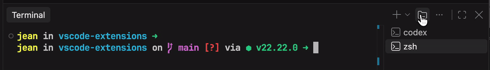

# Workspace Root Terminal

**Open a terminal at the root of your multi-root workspace in one click.**

In a `.code-workspace` with several folders, VS Code always asks which folder to open a new terminal in. The workspace root, meaning the folder that holds the `.code-workspace` file, is never on that list. Workspace Root Terminal adds it back without adding the root as a folder.

## Features

- **Root terminal button.** A dedicated button in the terminal panel (a folder with `>_`) opens a terminal at the workspace root right away, with no picker.
- **"Workspace Root" profile** in the native **⌄** menu next to **+**.
- **`Ctrl+`` with no terminal open** goes straight to the root instead of the folder picker.
- **Use it as the default:** run **Terminal: Select Default Profile → Workspace Root** to make **+** open at the root too.

In single-folder windows, everything opens in that folder.

## Why not a setting?

- `terminal.integrated.cwd` sends *every* terminal to one place.
- The folder picker behind **+** can't be extended.

This extension leaves both alone and gives the root its own entry point.
